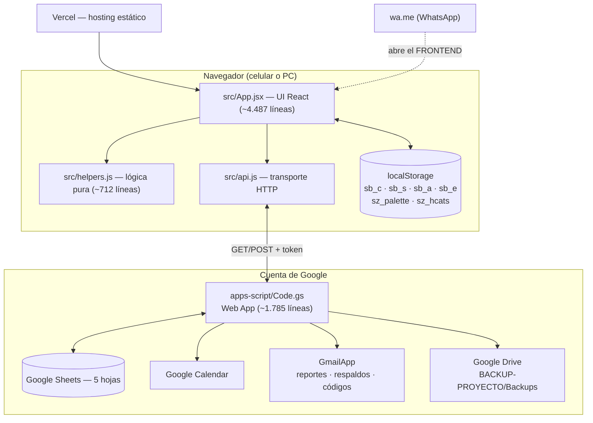

# 🏗️ Arquitectura y Funcionalidades — SZ

Informe técnico-funcional del sistema **tal como está implementado**. Cada regla
se cita con el **nombre real** de la función, componente o archivo que la
aplica.

> **Convención de sellos**
>
> - ✅ **Verificado en código** — se leyó la implementación en este repositorio.
> - 🧪 **Verificado en pruebas automatizadas** — existe un test que lo cubre
>   (273 pruebas, ejecutadas y en verde en esta ronda de documentación).
> - 🔎 **No verificado en producción** — la regla existe en el código pero no
>   se probó en el entorno real de Google/Vercel.

---

## Índice

1. [Arquitectura general](#1-arquitectura-general)
2. [Flujo frontend → API → Apps Script → Sheets/Calendar](#2-flujo-frontend--api--apps-script--sheetscalendar)
3. [Módulos y responsabilidades](#3-módulos-y-responsabilidades)
4. [Entidades y estructura de datos](#4-entidades-y-estructura-de-datos)
5. [Operaciones de lectura y escritura](#5-operaciones-de-lectura-y-escritura)
6. [Reglas de negocio de las citas](#6-reglas-de-negocio-de-las-citas)
7. [Validación de horarios y solapamientos](#7-validación-de-horarios-y-solapamientos)
8. [Editar, completar, inasistencia y eliminar](#8-editar-completar-inasistencia-y-eliminar)
9. [Servicios y citas dependientes](#9-servicios-y-citas-dependientes)
10. [Google Calendar](#10-google-calendar)
11. [Clientes y servicios](#11-clientes-y-servicios)
12. [Finanzas y fórmulas de reportes](#12-finanzas-y-fórmulas-de-reportes)
13. [Exportaciones y reportes](#13-exportaciones-y-reportes)
14. [Restablecimiento y autorización](#14-restablecimiento-y-autorización)
15. [Manejo de errores y recuperación](#15-manejo-de-errores-y-recuperación)
16. [Limitaciones conocidas](#16-limitaciones-conocidas)
17. [Matriz de funcionalidades](#17-matriz-de-funcionalidades)

---

## 1. Arquitectura general



**Principios de diseño confirmados:**

- **Sin servidor propio.** El estado persistente vive en Google Sheets.
- **Sin autenticación de usuario.** Hay **una sola usuaria**; la única barrera
  es el token de sincronización (`SB_SYNC_TOKEN`).
- **Lógica pura separada de la UI.** Todo lo testeable está en `helpers.js`
  (sin React ni `import.meta.env`), declarado en su cabecera (líneas 1–5).
- **Réplicas backend/frontend.** `Code.gs` **reimplementa** varias funciones de
  `helpers.js` para que el texto del correo sea idéntico al del WhatsApp. Esa
  duplicación está **cubierta por pruebas de paridad**.

---

## 2. Flujo frontend → API → Apps Script → Sheets/Calendar

### 2.1 Lectura (`doGet`)

```
App → loadData() → call('GET') → https://…/exec?token=…
   → doGet(e) → _checkToken → readSheet ×5 → JSON { ok, data }
   → App: setClients/setServices/setAppts/setExpenses + localStorage
```

- `doGet` está en `Code.gs` **línea 41**. ✅
- `loadData` está en `src/api.js` **línea 66**. ✅
- Devuelve **siempre las 5 colecciones completas** en una sola petición. ✅

### 2.2 Escritura (`doPost`)

```
App → saveData() → call('POST', {action, clients|services|…})
   → doPost(e) → JSON.parse → _checkToken
   → [_isDestructivePayload → _checkResetAuth → _consumeGrant]
   → LockService.getScriptLock()  (espera 8 s, si no: «busy»)
   → sanitize → trackPriceChanges → writeSheet
   → si hay calendarAction → create/update/deleteCalEvent
   → releaseLock() → { ok: true }
```

- `doPost` está en `Code.gs` **línea 57**. ✅
- El **Lock** serializa escrituras concurrentes (líneas 95–102). ✅
- El orden es importante: **se consume el grant ANTES de escribir nada**
  (línea 65), así un reset fallido no deja datos a medias. ✅ 🧪

### 2.3 Transporte (`src/api.js`)

| Elemento | Línea | Detalle |
|---|---|---|
| `URL` / `TOKEN` | 1–2 | `import.meta.env.VITE_SCRIPT_URL` y `VITE_TOKEN` |
| `MULTI_ACCOUNT_HINT` | 11 | Detecta `/macros/u/\d+/` y explica el problema de varias cuentas |
| `httpError()` | 15 | Traduce 404, 403, 429, 5xx y errores de red a mensajes accionables |
| `call()` | 47 | GET con `?token=` en query; POST con JSON en cuerpo |
| `loadData()` | 66 | `Promise.all` de 4 `saveData()` + `resetData` |
| `saveData()` | 54 | Envía `{action, <colección>}` |
| `resetData()` | 78 | `action:'resetData'` con `grantId`/`grantSecret` |

> ⚠️ **No se comprueba `response.ok`**: el estado se lee del campo `ok` del
> JSON. Si el servidor devuelve HTML (p. ej. 404 de Google), `JSON.parse`
> lanza y el error se enruta por `httpError`. ✅

### 2.4 Sincronización y estado offline

| Mecanismo | Ubicación | Comportamiento |
|---|---|---|
| Carga inicial | `App.jsx` 313–333 | `loadData()` → si falla, lee `localStorage` y marca `offline` |
| Polling | `App.jsx` 345 | Cada **30 s**, y al volver a la pestaña |
| Pausa con pestaña oculta | `App.jsx` 341 | `document.visibilitychange` |
| Escritura optimista | `App.jsx` 373–411 | Escribe el estado local y `localStorage` **antes** de la respuesta; si el servidor falla, lo **revierte** y avisa |
| Telemetría | — | **No hay.** Cero `console.log`/`fetch` a terceros. ✅ |

---

## 3. Módulos y responsabilidades

| Archivo | Líneas | Responsabilidad | ¿Testeado? |
|---|---:|---|:---:|
| `src/main.jsx` | 10 | Punto de entrada de React (`StrictMode`) | — |
| `src/App.jsx` | 4.487 | **Toda la UI** + estado global + orquestación de guardado | — (componentes no unit-testeados) |
| `src/helpers.js` | 712 | **Lógica pura**: fechas, slots, duraciones, estados, finanzas, reportes, servicio a domicilio, clasificación de citas | ✅ 144 tests |
| `src/api.js` | 83 | Transporte HTTP y mensajes de error | ✅ 7 tests |
| `apps-script/Code.gs` | 1.785 | Backend completo: API, seguridad, Sheets, Calendar, reportes, respaldos | ✅ 122 tests (en sandbox `node:vm`) |
| `src/backend.test.js` | 2.532 | Ejecuta `Code.gs` **real** con mocks de Apps Script | — |
| `src/helpers.test.js` | 1.212 | Pruebas unitarias de `helpers.js` | — |
| `src/api.test.js` | 89 | Pruebas del transporte | — |

### 3.1 Componentes de `src/App.jsx`

| Componente | Línea | Responsabilidad |
|---|---:|---|
| `Modal` | 595 | Diálogo de confirmación genérico |
| `PayModal` | 611 | Selección de método de pago al completar |
| `NavIcon` | 633 | Iconos SVG de la navegación |
| `SyncBadge` | 704 | Indicador de sincronización |
| `GS` | 716 | **Bloque `<style>` global** (tema, modo oscuro, responsive) |
| `Dashboard` | 1332 | Panel principal |
| `MonthlyIncomeState` | 1557 | Estado de ingresos por mes |
| `MonthlyBalance` | 1615 | Balance mensual |
| `ApptsTab` | 1691 | Lista de citas en acordeones |
| `ApptDetail` | 1861 | Detalle de una cita |
| `ApptCard` | 1969 | Tarjeta de cita reutilizable |
| `EditAppt` | 2054 | Formulario de edición |
| `NewWizard` | 2344 | Asistente de nueva cita (4 pasos) |
| `ClientsTab` | 2673 | Clientas y búsqueda |
| `ServicesTab` | 2774 | Catálogo de servicios |
| `FinancesTab` | 2853 | Finanzas (tarjetas y secciones) |
| `CalendarMonth` | 3151 | Vista mensual |
| `ClientHistory` | 3282 | Historial de clienta |
| `IncomeDetail` | 3446 | Detalle de ingresos |
| `ExpenseDetail` | 3859 | Detalle de gastos |
| `ReportTab` | 3941 → *ver matriz* | Reportes y exportación |
| `ComparisonTab` | 4188 | Comparación de meses |
| `TopServices` | 4272 | Top servicios |
| `SettingsTab` | 3941 | Ajustes y restablecimiento |

> 📌 **Nota de diseño:** `App.jsx` concentra la UI en un archivo único
> **a propósito** (documentado en el `README.md`). La lógica reutilizable vive
> fuera, en `helpers.js`, precisamente para poder testearla.

---

## 4. Entidades y estructura de datos

### 4.1 Definición canónica en el backend

Están en `Code.gs` **líneas 19–39** (`SHEETS`, `JS_KEYS`, `HEADERS_ES`) y se
repiten en `helpers.js` (`DEFAULT_SERVICES`, `emptyState`). ✅

#### `clients` → hoja **Clientes** (4 columnas)

| Campo | Tipo | Notas |
|---|---|---|
| `id` | string | Identificador único |
| `name` | string | |
| `phone` | string | Celular |
| `createdAt` | string | Fecha de registro |

#### `services` → hoja **Servicios** (4 columnas)

| Campo | Tipo | Notas |
|---|---|---|
| `id` | string | |
| `name` | string | **Puede contener comas** |
| `price` | number | Precio |
| `duration` | number | Minutos (15–480) |

#### `appointments` → hoja **Citas** (20 columnas)

| Campo | Tipo | Notas |
|---|---|---|
| `id` | string | |
| `clientId` | string | |
| `clientName` | string | **Snapshot** |
| `clientPhone` | string | **Snapshot** |
| `serviceIds` | string | **CSV** de ids |
| `serviceNames` | string | **CSV** — *snapshot histórico* |
| `servicePrice` | number | Suma de precios **al momento de crear** |
| `servicePrices` | string | JSON `{id: precio}` |
| `domicilio` | boolean | ¿Es a domicilio? |
| `domicilioPrice` | number | Valor del domicilio |
| `totalPrice` | number | **Total = servicios + domicilio** |
| `address` | string | Dirección (opcional) |
| `date` | string | `YYYY-MM-DD` |
| `time` | string | `HH:MM` |
| `createdAt` | string | `YYYY-MM-DDTHH:mm:ss` local |
| `calendarCreated` | boolean | ¿Se creó el evento? |
| `calendarEventId` | string | ID en Google Calendar |
| `completed` | string | `true` / `false` / `noshow` |
| `duration` | number | Duración total en minutos |
| `paymentMethod` | string | `Efectivo` / `Transferencia` |

#### `expenses` → hoja **Gastos** (5 columnas)

`id` · `description` · `amount` · `category` · `date`

#### `priceHistory` → hoja **HistorialPrecios** (4 columnas)

`serviceId` · `serviceName` · `price` · `changedAt`

### 4.2 Reglas de snapshot

- **`serviceNames` es una foto histórica**: los nombres de servicios **no se
  actualizan** si luego cambias el catálogo (`App.jsx` 2260). ✅
- **`servicePrice` conserva el precio de cuando se creó la cita**, y el precio
  por servicio queda en `servicePrices` (`{id:precio}`, línea 2259). ✅
- Por eso **editar un servicio no reescribe las citas viejas**. 🧪

---

## 5. Operaciones de lectura y escritura

### 5.1 `readSheet(ss, key)` — `Code.gs` 1871

| Situación | Comportamiento |
|---|---|
| Hoja con menos de 2 filas | Devuelve `[]` |
| **Más columnas** de las esperadas | Ignora las extras y hace `console.warn` |
| **Menos columnas** | Los campos faltantes llegan como `''` y avisa |
| Filas **sin ID en la columna A** | Se descartan |
| Celdas | Todas se leen como texto; `cellStr` (1901) normaliza fechas y horas |

### 5.2 `writeSheet(ss, key, arr)` — `Code.gs` 1891

```
sh.clearContents()  →  setValues([[HEADERS_ES[key]]])  →  setValues(filas)
sh.autoResizeColumn(1..n)          sh.getRange(1,1,rows,cols).setNumberFormat('@')
```

⚠️ **Reescribe la hoja completa en cada guardado.** Consecuencias:

- Ediciones manuales en la hoja **se pierden**.
- Las columnas fuera del esquema **se eliminan**.
- `autoResizeColumn` solo **ensancha**, nunca estrecha (no rompe el layout).

### 5.3 `sanitizePayload(b)` — `Code.gs` 1667

Aplica a cada campo numérico una **clausura de saneamiento**:

- No numérico → `0` (con `logRejected` → `console.warn` para auditoría)
- Montos: si son negativos → **`0`** (defensa en profundidad; la UI ya lo
  impide con `Math.max`)
- `duration`: se recorta al rango **15–480**; vacío → `60`
- `domicilioPrice`: también negativo → `0`
- `paymentMethod`: `in ('Efectivo','Transferencia')`, si no → `null`
- `completed`: se normaliza a `'true' | 'false' | 'noshow'`
- **Se eliminan claves desconocidas** y claves `__proto__` / `constructor` /
  `prototype` (prevención de **pollución de prototipos**). ✅

> 📌 Los filtros de montos van **antes** de la clausura (línea 1671), así que
> los campos sí validados no se marcan como rechazados.

### 5.4 `trackPriceChanges(oldSvcs, newSvcs)` — `Code.gs` 1834

Antes de guardar servicios, compara precio viejo vs. nuevo y registra cada
cambio en **HistorialPrecios** con `Utilities.formatDate(..., 'yyyy-MM-dd')`.
**No borra entradas** ni registra cambios que no existan. ✅ 🧪

### 5.5 `seedPriceHistory()` — `Code.gs` 442

Al ejecutarse, si **HistorialPrecios está vacía**, siembra un registro
inicial por cada servicio con `changedAt = createdAt` de la clienta. Así el
gráfico de historial **siempre tiene un punto de partida**. ✅ 🧪

---

## 6. Reglas de negocio de las citas

### 6.1 Agenda y bloques

| Regla | Valor | Implementación | Estado |
|---|---|---|:---:|
| Bloques | 07:00 → 20:30, cada 30 min | `TIME_SLOTS` (`helpers.js` 9–13) | ✅ 🧪 |
| Hora de cierre | **21:00** — una cita no puede **terminar** después | `CLOSING_TIME` (`helpers.js` 103) + `getSlots` (138–156) | ✅ 🧪 |
| Duración por defecto | 60 min | `SERVICE_DURATION` (`helpers.js` 15) | ✅ 🧪 |
| Duración válida | 15–480 min | `safeDuration` (`Code.gs` 776, `helpers.js` 106) | ✅ 🧪 |
| Duración de la cita | **suma** de sus servicios | `sumDuration` (`helpers.js` 112) | ✅ 🧪 |
| Zona horaria | `America/Bogota` | `appsscript.json` | ✅ |

**Ejemplo de la regla de cierre:** una cita a las **20:30** solo cabe si dura
**30 min** (termina exactamente a las 21:00). Con un servicio de 60 min, ese
bloque **no aparece**. 🧪

### 6.2 Estados de vida de una cita

`apptLife(a, now)` (`helpers.js` 41–53) devuelve `'past' | 'live' | 'future'`
y es **la única fuente de verdad** de la que cuelgan otras reglas. ✅ 🧪

| Estado | Definición |
|---|---|
| `past` | Terminó (según `duration`) **o** ya no es hoy y la fecha es pasada |
| `live` | Empezó pero **no ha terminado** (solo si es hoy) |
| `future` | Todavía no empieza |

### 6.3 Grupo visual de la lista de citas

`apptGroup(a, now)` (`helpers.js` 56–74), usado por `ApptsTab` (`App.jsx`
1718):

| Grupo | Condición |
|---|---|
| `noshow` | `completed === 'noshow'` |
| `today` | `date === hoy` |
| `tomorrow` | `date === mañana` |
| `upcoming` | `date > mañana` |
| `past` | todo lo demás |

> 📌 **«Pasada» es una fecha, no un estado.** Un `completed === 'false'` de
> ayer cae en `past`, **no** cambia de estado. Documentado también en el
> manual de usuario, sección 8.

### 6.4 Autocompletado por horario

El agente de tiempo (`App.jsx` 335–343) marca **automáticamente** como
`completed` toda cita `future` cuyo fin ya venció, y **elimina** toda cita
borrada (`calStatus === 'deleted'`).

> ⚠️ **Limitación confirmada:** si el navegador **no está abierto** a la hora
> del fin, **no se dispara**. La cita queda `completed` la próxima vez que se
> abra la app.

### 6.5 Precios

```
totalPrice = sum(servicePrices) + (domicilio ? domicilioPrice : 0)
```

- `servicePrice` = suma de los precios **al crear**. ✅
- Al **editar servicios** de la cita, `servicePrice` **se recalcula** pero
  `paymentMethod` **se conserva** (`App.jsx` 2267–2273). ✅ 🧪
- Los precios **negativos** se rechazan en la UI (`setPErr`, `App.jsx` 2777,
  2796) **y** los sanea el backend. ✅ 🧪

---

## 7. Validación de horarios y solapamientos

### 7.1 `checkSlot` — `helpers.js` 175–188

| Caso | Devuelve | Significado |
|---|---|---|
| Hora fuera de `TIME_SLOTS` | `'invalid'` | No existe ese bloque |
| Solapa con **otra** cita | `'taken'` | Horario ocupado |
| Termina después de **21:00** | `'late'` | Excede el cierre |
| Fin ya **venció** | `'ended'` | No se agendan horas en el pasado |
| Con `date` vacío | `'nodate'` | Falta elegir el día |
| Sin conflicto | `null` | **Libre** ✅ |

**Cálculo de solape** (`overlap`, `helpers.js` 158–173):

```
nuevoInicio < finExistente  &&  finNuevo > inicioExistente
```

Con tolerancia de 1 minuto (una cita que termina exactamente cuando empieza
otra **no solapa**). ✅ 🧪

### 7.2 ¿Dónde se valida?

> ⚠️ **`checkSlot` se ejecuta SOLO en el cliente** (`NewWizard`, `App.jsx`
> 2440; `EditAppt`, 2062).
>
> El backend **NO** vuelve a comprobar solapes: `doPost` delega en
> `calendarAction` (`createCalEvent` / `updateCalEvent`) **sin** validar
> choques. 🧪
>
> **Consecuencia:** dos personas agendando **a la vez desde dos dispositivos**
> pueden tomar la misma hora. `LockService` evita **corromper la hoja**, pero
> **no evita el doble reloj**. Es una limitación conocida, no un defecto
> oculto.

### 7.3 Detección de conflictos ya guardados

`buildConflictMap(appts, now)` (`helpers.js` 94–136) agrupa por `date+time`
las citas con `life !== 'past'` y devuelve cuántas hay en cada hueco. Se usa en
`NewWizard` y `EditAppt` para **deshabilitar** las horas tomadas. ✅ 🧪

---

## 8. Editar, completar, inasistencia y eliminar

### 8.1 Regla central: **solo las pendientes se modifican**

```
allowEdit     = appt.completed === 'false'      →  else «Solo las citas pendientes se pueden editar.»
allowDelete   = appt.completed === 'false'      →  else «Solo las citas pendientes se pueden eliminar.»
```

| Situación | ¿Editar? | ¿Eliminar? |
|---|:---:|:---:|
| 🟡 `completed === 'false'` | ✅ | ✅ |
| ✅ `completed === 'true'` | ❌ | ❌ |
| ❌ `completed === 'noshow'` | ❌ | ❌ |

**Implementación:** `EditAppt` (`App.jsx` 2061), `ApptDetail` (1897–1945) y
`deleteAppt` (464). 🧪 (cubierto en `helpers.test.js` y `backend.test.js`)

### 8.2 Flujo de «Completar»

```
«✓ Completar» → PayModal (Efectivo / Transferencia)
   → { completed:'true', paymentMethod }
   → saveData({ appointments })
```

`paymentMethod` se valida en el backend contra `in ('Efectivo','Transferencia')`
(`sanitizePayload`, `Code.gs` 1706). ✅ 🧪

### 8.3 Flujo de «No asistió»

```
«✗ No asistió» → confirm → { completed:'noshow' }
```

En los reportes, **«No asistió» aparece solo como número**, nunca como monto
(`reportLines`, `helpers.js` 478–561). ✅ 🧪 (prueba de paridad)

### 8.4 Eliminar una cita — `deleteAppt` (`App.jsx` 464–511)

**Secuencia real (4 pasos):**

1. Guarda el `calendarEventId`.
2. **Espera** la confirmación del servidor de que la cita se borró de la hoja.
3. Borra **solo** el evento de **esa** cita con `calDelete(appt.calendarEventId)`
   y comprueba `r.ok`.
4. Si falla → `confirm()` ofreciendo **reintento**; si el reintento también
   falla → `infoModal()` con el **ID del evento** para borrarlo a mano.

> 📌 **No se hace rollback.** Si el paso 3 falla, la cita **ya no está en
> Sheets** y el evento queda huérfano: la app prefiere **informar y dar vía de
> reintento** antes que inventar una transacción atómica que Sheets y Calendar
> no soportan. ✅ (documentado en el propio código, líneas 494–496)

---

## 9. Servicios y citas dependientes

### 9.1 Regla de eliminación

**No se puede eliminar un servicio que todavía tengan citas futuras activas o
en curso.**

| Bloqueadores | No bloquean |
|---|---|
| Citas con `life === 'future'` | Citas **pasadas** |
| Citas con `life === 'live'` | Completadas viejas |
| | No asistidas viejas |

### 9.2 Doble validación (cliente **y** servidor)

| Capa | Función | Archivo |
|---|---|---|
| Cliente | `serviceDeletionCheck(service, appts, services, now)` | `helpers.js` 411–458 |
| Servidor | `_serviceDeletionError(newServices, curServices, appts, now)` | `Code.gs` 642–677 |

**Ambas aplican los mismos criterios:**

1. **Por ID**: si la cita tiene `serviceIds`, compara **solo por id**.
2. **Por nombre**: solo si la cita **no** tiene ids y el nombre **no es
   ambiguo**.
3. **Ambigüedad**: si **dos o más servicios** comparten nombre normalizado
   (`normName`), el nombre **no sirve** para decidir y **se omite** — para no
   bloquear por un servicio homónimo. ✅ 🧪

**Resultado en el cliente:** `{ok, count, blockers, message}` con un mensaje
concreto. Si el servidor rechaza igual, el `deleteAppt` **revierte el estado
local** (`App.jsx` 467–470). ✅ 🧪

### 9.3 Resolución de servicios en reportes

`apptServiceRefs(a, services)` (`helpers.js`) **resuelve los servicios de una
cita contra el catálogo por `id`**. Esto es crítico porque `serviceNames` es un
CSV **ambiguo**: un servicio puede llamarse
`Diseño, depilación y sombreado`.

| Caso | Comportamiento |
|---|---|
| La cita trae `serviceIds` | Resuelve **por id** contra el catálogo |
| 1 solo servicio sin catálogo | Usa **el texto completo** del snapshot (sobrevive a un catálogo sin cargar) |
| Varias citas sin catálogo | Toma el snapshot **en la misma posición** |
| Sin ids (citas antiguas) | Recién ahí se **parte por coma** (último recurso) |

> 📌 **Bug corregido:** antes se partía `serviceNames` por coma siempre, lo que
> **inventaba entradas fantasma** en los rankings y **desalineaba** la
> búsqueda de precios (que indexaba por posición). `topServicesByDemand(appts,
> services)` comparte esa misma resolución y mantiene el **orden de
> inserción** en los empates (sort estable).

---

## 10. Google Calendar

### 10.1 Operaciones

| Operación | Función | Línea | Comportamiento |
|---|---|---:|---|
| **Crear** | `createCalEvent` | 679 | Crea en el calendario **por defecto**, color `MAUVE`, sin invitaciones → `{ok, eventId}` |
| **Actualizar** | `updateCalEvent` | 710 | Usa **solo** el id que trae la cita; **nunca crea**. Comprueba **después** de escribir que Calendar aplicó la hora (tolerancia 1 s); si no → `{ok:false, error:'not_applied'}` |
| **Borrar** | `deleteCalEvent` | 764 | Usa solo el id. Si no existe → `{ok:true, alreadyGone:true}` (**idempotente**). **Nunca** barre el calendario |

### 10.2 Contenido del evento

| Elemento | Valor |
|---|---|
| Título | `✨ <servicios> — <cliente>` (`calTitle_`, 693) |
| Descripción | Cliente, celular, servicios, total y — si es a domicilio — valor y dirección (`calDescription_`, 697) |
| Color | `MAUVE` |
| Invitaciones | **No se envían** (`addGuests` ausente) |

### 10.3 Integración con la API de citas

En `doPost` (línea 72) el flujo es:

```
writeSheet  →  si hay calendarAction  →  create/update/deleteCalEvent
             →  si ok:true, se persiste calendarEventId / calendarCreated
             →  si ok:false, se devuelve el error al cliente
```

| Acción en la app | `calendarAction` |
|---|---|
| Crear cita | `create` |
| Editar (fecha/hora/servicios) | `update` |
| Eliminar | `delete` |
| Completar / marcar no asistió | **ninguno** (no afecta al evento) |

### 10.4 ¿Y si la sincronización falla?

**No hay transaccionalidad entre Sheets y Calendar.** El diseño acepta eso
explícitamente:

- **Borrado:** avisar + reintento + mostrar el ID (`App.jsx` 498–510).
- **Edición:** si Calendar no aplicó la hora, el backend devuelve error y la
  app **no** comunica el éxito.
- **Reset:** los eventos se borran **desde el servidor** dentro de la
  operación ya autorizada (`_resetData`, 457–476); el frontend no borra nada
  antes de autorizar.

> 🔎 **No verificado en producción:** la existencia de eventos en un entorno
> real de Google. Cubierto en `backend.test.js` con mocks de `CalendarApp`.

---

## 11. Clientes y servicios

### 11.1 Clientes

| Función | Implementación | Regla |
|---|---|---|
| Búsqueda | `clientMatch` / `ClientHistory` (`helpers.js`, `App.jsx` 2702) | **Sufijo** del celular primero, luego **subcadena** del nombre |
| Alta al agendar | `NewWizard` (`App.jsx` 2397) | Si el nombre no existe → se crea con `uid()` |
| Historial | `ClientHistory` (3282) | Citas, montos, última visita |
| Reutilización | — | ⚠️ Si **2 clientas** comparten celular, **no** se fusionan |

### 11.2 Servicios

| Función | Implementación |
|---|---|
| Crear | `ServicesTab.add` (`App.jsx` 2779): `{id:uid(), name, price, duration}` con `price ≥ 0` |
| Editar | `ServicesTab` (2794): recalcula `price` con `Math.max(0, …)` |
| Duración | Selector de 60 min por defecto; opciones 30/60/90/120/150/180 (`App.jsx` 237) |
| Eliminar | `tryDelete` (2784) → `serviceDeletionCheck` → confirm → `SS(next)` |
| Historial de precios | `trackPriceChanges` (`Code.gs` 1834) en el servidor |

### 11.3 Catálogo por defecto

`DEFAULT_SERVICES` (`helpers.js`) trae **9 servicios precargados** con precio y
duración, para que la app no arranque vacía.

---

## 12. Finanzas y fórmulas de reportes

### 12.1 Métricas (`reportMetrics`, `helpers.js`)

| Métrica | Fórmula |
|---|---|
| **Ingresos recibidos** | Suma de `totalPrice` de citas con `completed === 'true'` |
| **Pendiente** | Suma de `totalPrice` de citas con `completed === 'false'` |
| **Proyectado** | Recibido + pendiente |
| **Gastos** | Suma de `amount` de los gastos del período |
| **Balance neto** | Ingresos recibidos **−** gastos |
| **No asistidos** | **Conteo** de citas con `completed === 'noshow'` (**nunca dinero**) |

> 📌 **«No asistió» es un número.** Existe una **prueba de paridad** que
> compara el texto del WhatsApp con el del correo y falla si aparece como
> monto. ✅ 🧪

### 12.2 Períodos (`periodLedger`, `helpers.js`)

| Tipo | Selección | Etiqueta |
|---|---|---|
| `day` | `date === YYYY-MM-DD` | `Día d mmm` |
| `month` | `date` con prefijo `YYYY-MM` | `Mes yyyy MM` |
| `range` | `from ≤ date ≤ to` | `Día d mmm` … `—` … |
| **`year`** | `y-01-01 ≤ date ≤ y-12-31` | **`Año y`** |

⚠️ **La etiqueta `Año <y>` debe ser byte-idéntica** entre `helpers.js` y
`Code.gs`; si difiere, falla la prueba de paridad. 🧪

### 12.3 Detalle de gastos — regla de 8

| Situación | Comportamiento |
|---|---|
| **≤ 8** gastos | Se listan **uno por línea** |
| **> 8** gastos | **Una línea por categoría**, de mayor a menor, con conteo: `Gasolina: $150.000 (5)` |
| **> 20** categorías | Se muestran las **20 primeras** y avisa `… y N más` |
| Sin categoría | Van a un solo cubo **`Sin categoría`** |

**Constantes:** `REPORT_EXPENSE_DETAIL_MAX = 8` y
`MAX_REPORT_EXPENSES = 20` (`helpers.js` 688 y 681); réplicas
`DETALLE_MAX`/`MAX_EXP` en `Code.gs` 1547/1552. ✅ 🧪

> ⚠️ **Regla invariante:** el **`• Total gastos`** siempre suma **todo** el
> período **sin importar cuántas líneas se muestren**. Es una propiedad con
> prueba explícita. 🧪
>
> ⚠️ El **Excel exportado desde la app sí trae TODOS los gastos**, línea por
> línea: la agrupación aplica **solo** al texto del mensaje. 🧪

### 12.4 Reparto por método de pago

`splitPaid(appts)` (`helpers.js`): separa lo cobrado en **Efectivo** y
**Transferencia** según `paymentMethod`. 🧪

### 12.5 Paginación de las tres listas largas

Tres listas pueden crecer sin control y saturaban la pantalla del celular,
así que se paginan con **10 registros por página** (`PAGE_SIZE = 10`,
`App.jsx`):

| Lista | Componente | Se reinicia al… |
|---|---|---|
| **📋 Gastos del mes** | `FinancesTab` | cambiar de **mes** |
| **🧾 Movimientos del período** | `ReportTab` | cambiar de **período** (`mode`, `day`, `month`, `year`, `from`, `to`) o de **filtro** (`mvFilter`) |
| **💚 Detalle Ingresos** (lista de **días**) | `IncomeDetail` | cambiar de **mes** o de **filtro** (`filter`: Todo / Recibido / Pendiente / No asistió) |

> 📌 En `IncomeDetail` se pagina la lista de **tarjetas de día** (el bloque
> `byDay`), no cada cita: es la unidad que se lista bajo cada filtro. Cada
> tarjeta de día conserva **todas** sus citas visibles.

**Reglas del control `Pager` (`App.jsx`, tras `SyncBadge`):**

| Regla | Implementación |
|---|---|
| **No aparece** si la lista cabe entera (`total <= PAGE_SIZE`) | `if (total <= PAGE_SIZE) return null` |
| Muestra el rango y la posición: `1–10 de 37 movimientos · pág. 1 de 4` | `first`/`last` calculados sobre el total, **no** sobre la página |
| El rango se **recorta siempre** dentro de `[1, pages]` | `Math.min(Math.max(1,page),pages)` — una lista que encoge nunca deja la vista vacía |
| **‹ Ant.** deshabilitado en la primera página, **Sig. ›** en la última | `disabled` + opacidad 0,4 |
| El estado lo lleva el **padre**, no el propio `Pager` | `expPage` / `mvPage` + `useEffect` de reinicio |

> ⚠️ **Invariante crítico:** los totales **no** se recalculan por página.
>
> - En `FinancesTab`, los balances salen de `monthLedger(safeA, safe, month)`,
>   que recibe **todos** los gastos del mes.
> - En `ReportTab`, el **Neto del período** sale de `M.neto` (`reportMetrics`
>   sobre el `ledger` completo), **no** de `mvShown`.
> - En `IncomeDetail`, los montos y contadores de las 4 tarjetas salen de
>   `ma` / `done` / `pend` / `noshow` **completos**, **no** de `dayShown`.
>
> Verificado en el navegador: el neto se mantiene **idéntico** al paginar
> entre las 4 páginas de un período de 37 movimientos, y en Detalle Ingresos
> las 4 tarjetas se mantienen iguales al pasar de página y al cambiar de
> filtro (Todo $10.150.000 / 29 citas en todas las páginas y filtros de un
> mes de prueba).

> 📌 **Limpieza incidental:** al paginar, el filtro de movimientos se refactorizó
> para calcularse **una sola vez** (`mvRows`); antes `ledger.rows.filter(…)`
> se ejecutaba **dos veces** (una para el chequeo de vacío y otra para el
> `.map`).

---

## 13. Exportaciones y reportes

### 13.1 Exportación a Excel desde la app (SheetJS)

`exportExcel()` en `ReportTab` (`App.jsx` 3542):

- Usa la librería **`xlsx` 0.18.5** (dependencia de producción).
- Genera **3 hojas**: **Resumen · Citas · Gastos**.
- **Trae todos los gastos, línea por línea** (no agrupados).
- Descarga como `.xlsx`.

### 13.2 Reporte por WhatsApp (frontend)

- `sendWA` construye el texto con `reportLines` y abre **`wa.me`** con el
  número del admin (`VITE_ADMIN_WHATSAPP`).
- Si no hay número configurado, **el botón sale deshabilitado** (`App.jsx`
  206–213). ✅

### 13.3 Reportes por correo (Apps Script)

| Función | Línea | Dispara | Período | Guard |
|---|---:|---|---|---|
| `sendDailyReportEmail` | 1709 | diario 12:00 | hoy | — |
| `sendWeeklyReportEmail` | 1723 | domingo 12:00 | Lun–Dom | si hoy no es domingo → `SKIP` |
| `sendMonthlyReportEmail` | 1754 | diario 12:00 | mes en curso | si no es el último día → `SKIP` |
| `sendYearlyReportEmail` | 1770 | diario 12:00 | 1 ene – 31 dic | si hoy no es 31 dic → `SKIP` |

**`setupAllReportTriggers()` (1790) instala 4 triggers** de forma idempotente. ✅

> 📌 **Por qué se disparan a diario:** Apps Script **no tiene** trigger de
> «último día del mes/año». Por eso la función misma decide no enviar. Ver
> `SKIP …` en los registros es **normal**.

### 13.4 El adjunto `.xlsx` generado por Apps Script

`_buildReportXlsx` (`Code.gs` 1025) — **no usa SheetJS**:

```
SpreadsheetApp.create()  →  poblar con setValues  →  SpreadsheetApp.flush()
   →  Utilities.sleep(1500)
   →  UrlFetchApp.fetch(Drive URL + UrlFetchApp.getOAuthToken())
   →  resp.getBlob().getBytes()          ← NO resp.getBytes()
   →  validar que empiece por «PK» (ZIP real)
   →  ¿no? → reintentar (máx. 3)  ¿sí? → adjuntar y File.setTrashed(true)
```

| Decisión | Motivo |
|---|---|
| `flush()` + `sleep(1500)` | Evita el **xlsx vacío con HTTP 200** (datos aún no volcados) |
| Validar prefijo `PK` | Un ZIP válido empieza por `PK`; si no, el archivo está vacío |
| **3 intentos** | Cubre la latencia eventual de Drive |
| `resp.getBlob().getBytes()` | **`HTTPResponse` no tiene `getBytes()`** — eso rompía en producción |
| **Si todo falla** | **El correo se envía igual, sin adjunto** y el HTML muestra `⚠ El Excel del reporte no se pudo generar: el correo va sin adjunto.` |

**Nombre del archivo** (`_xlsxName`, 1493):

| Período | Nombre |
|---|---|
| día | `reporte_YYYY-MM-DD.xlsx` |
| mes | `reporte_YYYY-MM.xlsx` |
| **año** | **`reporte_YYYY.xlsx`** |
| rango | `reporte_DE_DESDE_A_HASTA.xlsx` |

**Columnas** (`anchosDe`, 1451): anchos en **píxeles** (`caracteres * 7 + 5`)
**más** `autoResizeColumns(1, n)`, dentro de un `try/catch` cosmético — un fallo
de formato **nunca** debe romper el envío. ✅

### 13.5 Paridad WhatsApp ↔ correo

> 📌 **Regla:** el texto del WhatsApp y el del correo deben ser **exactamente
> el mismo**. `backend.test.js` importa `reportLines` del frontend y lo compara
> con la salida de `_buildReport`. Cualquier divergencia **rompe la suite**. 🧪
>
> Las réplicas en `Code.gs` (`_groupExpenses`, `_topServicesByDemand`) están
> comentadas como «MISMO orden y mismo criterio de desempate (por nombre, SIN
> `localeCompare`, que puede variar entre entornos)».

---

## 14. Restablecimiento y autorización

### 14.1 Token de sincronización

| Propiedad | Detalle |
|---|---|
| Backend | `TOKEN_PROP_KEY = 'SB_SYNC_TOKEN'` (`Code.gs` 15) |
| Frontend | `VITE_TOKEN` (`api.js` 2) |
| Verificación | `_checkToken` (241) |
| Si **falta** la propiedad | **Fail closed**: `«Token de sincronización no configurado: añade la propiedad SB_SYNC_TOKEN…»` |
| Si no coincide | `«No autorizado»` |
| Comparación | `_secureEqual` — **tiempo lineal** (230) |

> ⚠️ `VITE_TOKEN` **no es un secreto**: viaja en el bundle JS y en el query
> string. El auténtico es la propiedad del servidor.

### 14.2 El reset exige una autorización emitida por el servidor

El token **no basta** para destructivos. Se exige un **grant de un solo uso**.

| Paso | Función | Línea | Qué valida |
|---|---|---:|---|
| 1. Pedir código | `_requestResetCode` | 293 | Rate-limit: **3 envíos/hora** → si se agotan, bloqueo de **30 min**. Código de **8 caracteres** (`A-Z`, `2-9`, sin `0/O/I/1`). Vigencia **15 min**. Guarda **solo el hash**. Se envía **exclusivamente** al correo autorizado. **La respuesta siempre es idéntica** (no revela si el correo existe o si estás bloqueado). |
| 2. Verificar código | `_verifyResetCode` | 403 | Normaliza (quita espacios/saltos, mayúsculas) → compara **hashes** con comparación en **tiempo lineal**. Máx. **5 intentos**. **Un solo uso**. Si es válido → emite `grantId` + `grantSecret`, vigencia **10 min**, guardado **solo como hash**. |
| 3. Ejecutar | `_resetData` | 457 | `_checkResetAuth` → `_consumeGrant` (270): exige el grant y lo **consume antes de escribir nada**. No se puede repetir. |

### 14.3 ¿Cómo detecta el backend una operación destructiva?

`_isDestructivePayload(b)` (`Code.gs` 255):

```
action === 'resetData'
  OR resetPriceHistory truthy
  OR (más de UNA colección definida entre clients, services, appointments, expenses)
```

> 📌 Las sincronizaciones normales mandan **una sola** colección, así que
> **nunca** exigen grant. 🧪

### 14.4 Constantes de seguridad

| Constante | Valor | Línea |
|---|---|---:|
| `CODE_TTL_MS` | 15 min | 170 |
| `GRANT_TTL_MS` | 10 min | 171 |
| `MAX_VERIFY_TRIES` | 5 | 172 |
| `LOCKOUT_MS` | 30 min | 173 |
| `MAX_SENDS` / `SEND_WINDOW_MS` | 3 / 1 h | 174–175 |
| `CODE_ALPHABET` | 32 símbolos | — |

### 14.5 Recuperación si la respuesta del servidor se pierde

`resetAll` (`App.jsx` 414–456) contempla que el reset **se ejecutó pero la
respuesta se perdió**. En vez de asumir, **relee la hoja** y la compara
(`isResetOutcome`):

| Situación | Resultado |
|---|---|
| El servidor sí lo ejecutó | Aplica el estado local y reporta éxito (`confirmado: true`) |
| No se ejecutó | Pide código nuevo y lo dice claramente |
| No se pudo comprobar | Avisa de que hay que revisar la hoja |

> 🚨 **El reset borra:** `clients`, `services` (catálogo), `appointments`,
> `expenses`, `priceHistory` y **todos los eventos de Calendar** (466–476).
> **No se puede deshacer.**

---

## 15. Manejo de errores y recuperación

### 15.1 Mensajes de transporte (`src/api.js`)

| Caso | Mensaje |
|---|---|
| 404 con `/macros/u/\d+/` | *«Google reescribió la dirección con /u/N/…»* + hint de varias cuentas |
| 404 normal | *«Apps Script no encontró el Web App. Comprueba la URL y la versión publicada.»* |
| 403 | *«No autorizado: el token no coincide con SB_SYNC_TOKEN.»* |
| 429 | *«Demasiadas solicitudes…»* |
| 5xx | *«Apps Script está ocupado…»* |
| Error de red | *«Sin conexión a Internet o el servidor no responde…»* |

### 15.2 Modo offline

1. Si `loadData()` falla, se leen `localStorage` (`App.jsx` 326).
2. El badge cambia a **«⚠ Modo sin conexión»**.
3. Los `saveData()` **siguen funcionando** y se reintentan.

### 15.3 Escritura optimista con reversión

`App.jsx` 373–411:

```
setState(nuevo) + localStorage  →  saveData()
   → ok     → nada más
   → fallo  → REVERTIR el estado anterior + infoModal «No se pudo guardar»
```

### 15.4 Manejo de errores del backend

| Mecanismo | Lugar |
|---|---|
| `try/catch` global en `doPost` | Devuelve `{ok:false, error}` siempre en JSON |
| `console.error` en respaldos | `createDailyBackup`, `sendWeeklyBackupEmail` |
| `try/catch` cosmético en el Excel | `_buildReportXlsx` — un fallo de formato no rompe el envío |
| `catch(_){}` vacío en el correo de reset | `Code.gs` 320 — un fallo de Gmail **no** revela si el correo existe |

### 15.5 Integridad de datos

| Protección | Implementación |
|---|---|
| Escrituras concurrentes | `LockService.getScriptLock()` con espera de 8 s → `busy` |
| Pollution de prototipos | Se eliminan `__proto__`, `constructor`, `prototype` |
| Montos negativos | Saneados a `0` en el servidor |
| Duraciones absurdas | Recortadas a 15–480 |
| Filas sin ID | Descartadas al leer |
| Hojas con columnas de más | Ignoradas con `console.warn` |

---

## 16. Limitaciones conocidas

Confirmadas leyendo el código; **no son defectos ocultos**.

| # | Limitación | Dónde |
|---|---|---|
| 1 | **Sin roles ni sesión**: cualquiera con URL + token ve y edita todo | Arquitectura general |
| 2 | **`VITE_TOKEN` no es secreto** — va en el bundle público | `api.js` 1–2 |
| 3 | **La validación de horarios es solo en el cliente**: doble reloj posible entre dos dispositivos | `checkSlot`, `helpers.js` 175 |
| 4 | **No hay transaccionalidad Sheets ↔ Calendar**: posible evento huérfano | `deleteAppt`, `App.jsx` 494 |
| 5 | **El autocompletado por horario** solo corre si el navegador está abierto | `App.jsx` 335 |
| 6 | **`writeSheet` borra ediciones manuales** de la hoja | `Code.gs` 1891 |
| 7 | **Destinatario de reportes hardcodeado** en `_sendReportEmail` (1540) y `sendWeeklyBackupEmail` (908) | `Code.gs` |
| 8 | **Eventos de Calendar no se respaldan** | — |
| 9 | **Dos clientas con el mismo celular no se fusionan** | — |
| 10 | **Lógica duplicada** frontend ↔ backend (revelada por las pruebas de paridad) | `helpers.js` / `Code.gs` |
| 11 | **Los `VITE_*` requieren rebuild** — no cambian en caliente | Vite |
| 12 | **`App.jsx` es monolítico** (~4.487 líneas) — decisión deliberada, documentada | `App.jsx` |

---

## 17. Matriz de funcionalidades

| # | Funcionalidad | Archivo / función | ✅ Código | 🧪 Tests |
|---:|---|---|:---:|:---:|
| **CITAS** | | | | |
| 1 | Bloques 07:00–20:30 / 30 min | `helpers.js` `TIME_SLOTS` | ✅ | 🧪 |
| 2 | Cierre a las 21:00 | `helpers.js` `CLOSING_TIME`, `getSlots` | ✅ | 🧪 |
| 3 | Duración por servicio (15–480) | `helpers.js` `svcDuration`, `Code.gs` `safeDuration` | ✅ | 🧪 |
| 4 | Duración = suma de servicios | `helpers.js` `sumDuration` | ✅ | 🧪 |
| 5 | Detección de solapes | `helpers.js` `checkSlot`, `overlap` | ✅ | 🧪 |
| 6 | Mapa de conflictos | `helpers.js` `buildConflictMap` | ✅ | 🧪 |
| 7 | Estados de vida (`past/live/future`) | `helpers.js` `apptLife` | ✅ | 🧪 |
| 8 | Grupos de la lista | `helpers.js` `apptGroup` | ✅ | 🧪 |
| 9 | Múltiples servicios (combo) | `NewWizard`, `helpers.js` | ✅ | 🧪 |
| 10 | Cita a domicilio + dirección | `NewWizard`, `helpers.js` | ✅ | 🧪 |
| 11 | Total = servicios + domicilio | `helpers.js`, `Code.gs` | ✅ | 🧪 |
| 12 | Snapshot de precios al crear | `App.jsx` 2259–2260 | ✅ | 🧪 |
| 13 | Autocompletado por horario | `App.jsx` 335–343 | ✅ | — |
| 14 | Editar solo pendientes | `App.jsx` 2061, 1897 | ✅ | 🧪 |
| 15 | Eliminar solo pendientes | `App.jsx` 464 | ✅ | 🧪 |
| 16 | Método de pago al completar | `PayModal`, `sanitizePayload` | ✅ | 🧪 |
| 17 | Marcar no asistió | `App.jsx`, `helpers.js` | ✅ | 🧪 |
| **CALENDAR** | | | | |
| 18 | Crear evento | `Code.gs` `createCalEvent` (679) | ✅ | 🧪 |
| 19 | Actualizar con verificación post-escritura | `Code.gs` `updateCalEvent` (710) | ✅ | 🧪 |
| 20 | Borrar idempotente | `Code.gs` `deleteCalEvent` (764) | ✅ | 🧪 |
| 21 | Fallo de borrado → reintento + ID | `App.jsx` 489–511 | ✅ | — |
| **CLIENTES** | | | | |
| 22 | Búsqueda por sufijo/subcadena | `helpers.js` `phoneMatch`, `App.jsx` 2702 | ✅ | 🧪 |
| 23 | Alta automática al agendar | `App.jsx` 2397 | ✅ | — |
| 24 | Historial de clienta | `ClientHistory` (3282) | ✅ | — |
| **SERVICIOS** | | | | |
| 25 | Catálogo con precio y duración | `ServicesTab` (2774) | ✅ | 🧪 |
| 26 | Historial de precios | `Code.gs` `trackPriceChanges` (1834) | ✅ | 🧪 |
| 27 | Semilla del historial | `Code.gs` `seedPriceHistory` (442) | ✅ | 🧪 |
| 28 | No eliminar con citas futuras | `helpers.js` 411 + `Code.gs` 642 | ✅ | 🧪 |
| 29 | Nombres ambiguos no bloquean | `helpers.js` 421, `Code.gs` 664 | ✅ | 🧪 |
| 30 | Resolución de servicios por ID | `helpers.js` `apptServiceRefs` | ✅ | 🧪 |
| **FINANZAS** | | | | |
| 31 | Recibido / pendiente / proyectado | `helpers.js` `reportMetrics` | ✅ | 🧪 |
| 32 | Balance neto | `helpers.js` `reportMetrics` | ✅ | 🧪 |
| 33 | No asistido **solo como número** | `helpers.js` `reportLines` | ✅ | 🧪 |
| 34 | Gastos agrupados si > 8 | `helpers.js` `groupExpensesByCategory` | ✅ | 🧪 |
| 35 | Total gastos **siempre** = todo el período | `helpers.js` | ✅ | 🧪 |
| 36 | Reparto Efectivo / Transferencia | `helpers.js` `splitPaid` | ✅ | 🧪 |
| 37 | Comparación mes a mes | `ComparisonTab` (4188) | ✅ | 🧪 |
| 38 | Top servicios (ingresos y demanda) | `helpers.js` `topServicesByDemand`, `TopServices` (4272) | ✅ | 🧪 |
| 38b | **Paginación en «Gastos del mes»** (>10) | `App.jsx` `Pager`, `FinancesTab` | ✅ | — |
| 38c | **Paginación en «Detalle Ingresos»** (>10 días) | `App.jsx` `Pager`, `IncomeDetail` | ✅ | — |
| **REPORTES** | | | | |
| 39 | Períodos día / mes / rango / **año** | `helpers.js` `periodLedger` | ✅ | 🧪 |
| 40 | Excel con 3 hojas (app) | `App.jsx` `exportExcel` (3542), SheetJS | ✅ | — |
| 41 | Excel trae **todos** los gastos | `App.jsx` `exportExcel` | ✅ | 🧪 |
| 41b | **Paginación en «Movimientos del período»** (>10) | `App.jsx` `Pager`, `ReportTab` | ✅ | — |
| 42 | WhatsApp al admin | `App.jsx` `sendWA`, `wa.me` | ✅ | — |
| 43 | Correo con adjunto `.xlsx` | `Code.gs` `_buildReportXlsx` (1025) | ✅ | 🧪 |
| 44 | Fallback sin adjunto | `Code.gs` `_sendReportEmail` (1663) | ✅ | 🧪 |
| 45 | Paridad WhatsApp ↔ correo | `backend.test.js` | ✅ | 🧪 |
| 46 | Reportes automáticos (4) | `Code.gs` 1709–1787 | ✅ | 🧪 |
| 47 | Triggers idempotentes | `setupAllReportTriggers` (1790) | ✅ | 🧪 |
| **SEGURIDAD** | | | | |
| 48 | Token en Script Properties (fail closed) | `Code.gs` 15, 241 | ✅ | 🧪 |
| 49 | Código de reset por correo | `Code.gs` 293 | ✅ | 🧪 |
| 50 | Hash + comparación en tiempo lineal | `Code.gs` 218, 230 | ✅ | 🧪 |
| 51 | Vigencia 15 min / grant 10 min | `Code.gs` 170–171 | ✅ | 🧪 |
| 52 | 5 intentos + bloqueo 30 min | `Code.gs` 172–173 | ✅ | 🧪 |
| 53 | 3 envíos por hora | `Code.gs` 174–175 | ✅ | 🧪 |
| 54 | Grant de un solo uso | `Code.gs` 270 | ✅ | 🧪 |
| 55 | Detección de operación destructiva | `Code.gs` 255 | ✅ | 🧪 |
| 56 | Recuperación si se pierde la respuesta | `App.jsx` 414–456 | ✅ | 🧪 |
| **OPERACIÓN** | | | | |
| 57 | `LockService` para concurrencia | `Code.gs` 95 | ✅ | 🧪 |
| 58 | Saneamiento de montos y claves | `Code.gs` `sanitizePayload` (1667) | ✅ | 🧪 |
| 59 | Respaldo diario a Drive (30 días) | `Code.gs` `createDailyBackup` (802) | ✅ | 🧪 |
| 60 | Respaldo semanal por correo | `Code.gs` `sendWeeklyBackupEmail` (904) | ✅ | 🧪 |
| 61 | Polling 30 s + pausa con pestaña oculta | `App.jsx` 341–345 | ✅ | — |
| 62 | Modo offline con `localStorage` | `App.jsx` 313–333 | ✅ | — |
| 63 | Escritura optimista con reversión | `App.jsx` 373–411 | ✅ | — |
| 64 | Tema y paletas persistentes | `GS` (716), `localStorage` | ✅ | — |
| 65 | Branding dinámico (`VITE_BIZ_*`) | `App.jsx` 193–196, 347 | ✅ | — |
| 66 | Telemetría / análisis externo | **No existe** | ✅ | ✅ |

---

### Resumen de cobertura de verificación

| Sello | Significado |
|---|---|
| ✅ 🧪 | Verificado en código **y** cubierto por pruebas automatizadas |
| ✅ | Verificado en código, sin test unitario (mayormente UI) |
| 🔎 | No verificado en producción (integraciones reales de Google y Vercel) |

> ⚠️ **Ninguna funcionalidad fue probada manualmente en producción durante
> esta ronda de documentación.** Las 273 pruebas corren en un **sandbox con
> mocks** de Apps Script (`node:vm`), no contra Google real. La integración
> con Sheets, Calendar, Gmail, Drive y Vercel queda marcada como 🔎.

---

> 📖 **Documentos relacionados**
>
> - [`MANUAL_TECNICO.md`](MANUAL_TECNICO.md) — instalación y configuración
> - [`MANUAL_USUARIO.md`](MANUAL_USUARIO.md) — guía para la operadora
> - [`PRUEBAS_Y_MANTENIMIENTO.md`](PRUEBAS_Y_MANTENIMIENTO.md) — pruebas y diagnóstico
> - [`INDEX.md`](INDEX.md) — índice completo
